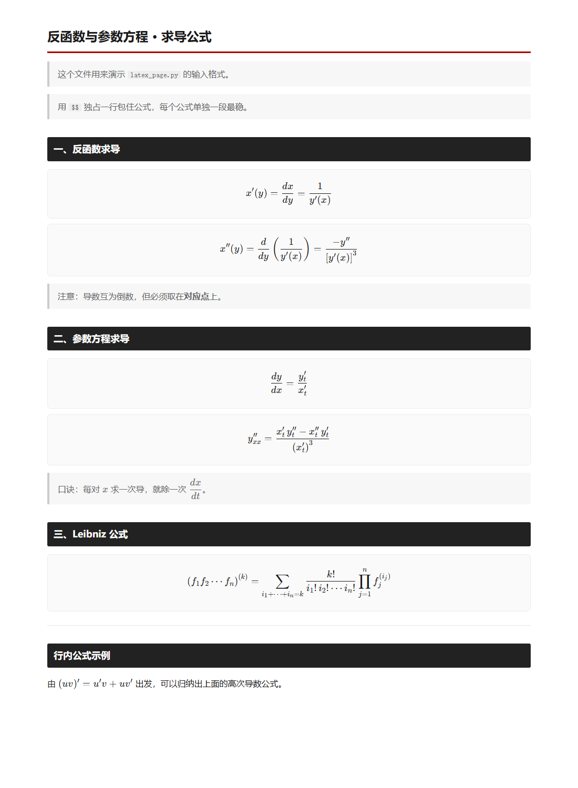

# latex-page — render LaTeX outside your chat client

**TL;DR**: if your Markdown client mangles `$$...$$` blocks, stop fighting it. Write formulas in Markdown, render them into a static HTML page you control — local KaTeX, works offline, prints cleanly.



---

## The problem

Some Markdown clients (including **certain versions of DeepSeek Harness**) pre-parse `$$...$$` before handing it to KaTeX:

- they only recognise a few `$$` shapes;
- unknown shapes are **silently treated as plain text** (no error);
- worse, they may **swallow the rest of the message**, so you see "first half fine, second half raw red source".

This is not a KaTeX bug and not your LaTeX syntax. See the upstream analysis:
[root cause of DSH `$$` parsing](https://github.com/TianzeLuo/dsh-tex-block-normalizer/blob/main/docs/root-cause.md)

**Our position**: don't patch someone else's renderer, don't memorise a list of formatting taboos — move the formulas to a page you own.

---

## What it does

```
notes.md  ──(latex_page.py)──▶  page.html  ──(browser / print)──▶  typeset math
```

- Input: Markdown with headings, paragraphs, quotes and `$$` blocks
- Output: one HTML file rendered with KaTeX
- Requires: Python 3.9+; KaTeX either local or from CDN

---

## Quick start

```bash
# A) CDN mode (no install, needs network)
python latex_page.py examples/formulas.md -o page.html --title "My formulas"

# B) Offline mode
npm install katex@0.16.11
python latex_page.py examples/formulas.md -o page.html --katex local

# C) Auto-detect
python latex_page.py examples/formulas.md -o page.html --katex auto
```

Open `page.html` in any browser. `Ctrl+P` prints it to A4.

---

## Input format (minimal Markdown subset)

| Syntax | Result |
|---|---|
| `# Title` / `## Title` / `### Title` | headings |
| `> quote` | callout block |
| `---` | horizontal rule |
| `**bold**` / `` `code` `` | inline formatting |
| `$$` on its own line … `$$` on its own line | display formula |
| `$x^2$` | inline formula |

**Rule of thumb**: keep the opening and closing `$$` on their own lines, with no blank line inside the block.

---

## Why not a browser extension

- Extensions break whenever the host app updates;
- a static page still opens ten years from now;
- you also end up with a printable, searchable, version-controlled personal formula sheet.

---

## Limitations

- minimal Markdown subset only (no tables, images or nested lists)
- complex environments such as `\begin{cases}` depend on KaTeX compatibility
- no syntax highlighting, no table of contents

PRs welcome: tables, TOC, themes.

---

## License

MIT
